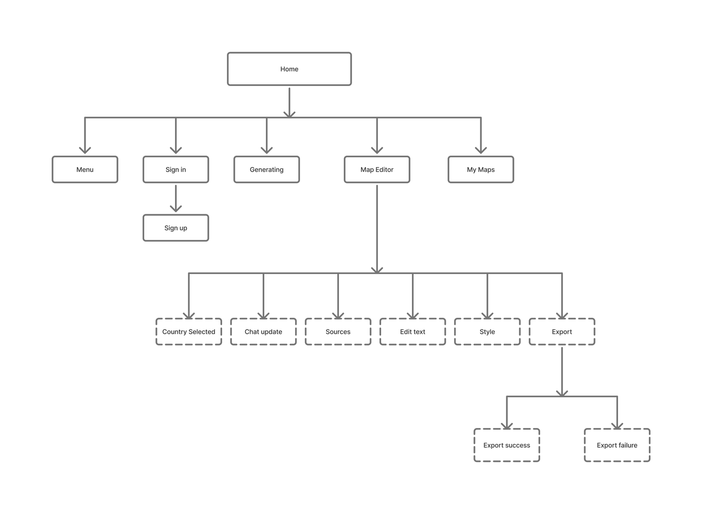
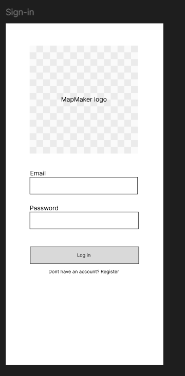
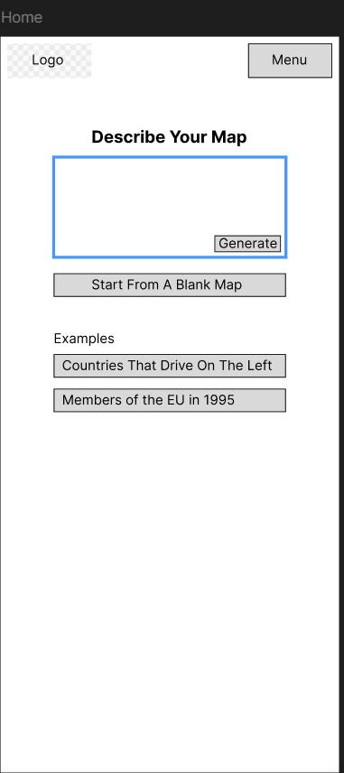
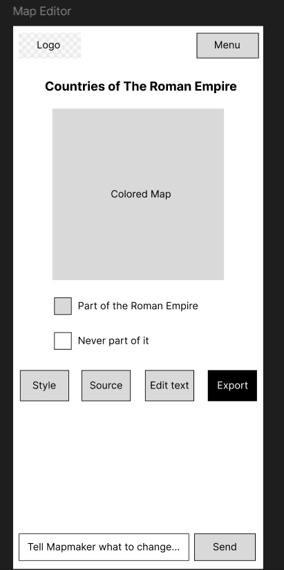
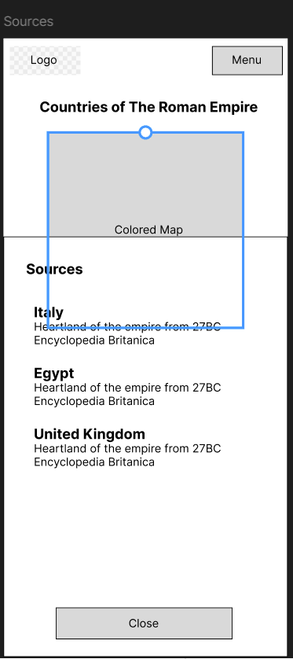
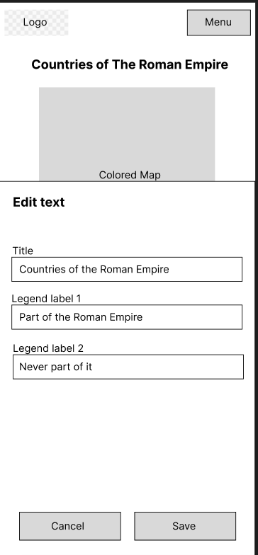
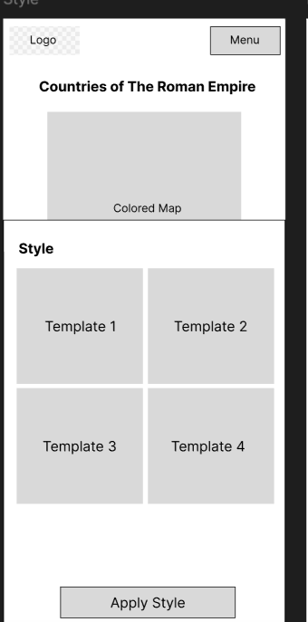
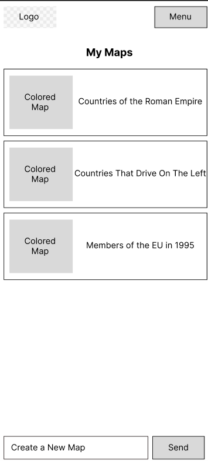

# User Experience Design

## App_Map/SiteMap

## Wireframes

### Sign in:
.

Login in page for user.
### Home Page:

Home page for MapMaker. As seen by App_Map, this is the root layer of Mapmaker app.

### Map Editor:

Page that shows how users can edit their maps. Users can choose the style, see what sources were used to construct their map, click to edit the map text, and finally export their map.

In addition, users can also prompt MapMaker using the chat function below

### Sources:

Shows user the sources used to construct the map

### Edit Text:

Page where users can edit text. 

### Style:

Page where user can select map style
### My Maps:

The page that contains all of the user's maps along with a picture of those maps

## Prototype:

[Figma Prototype](https://www.figma.com/proto/dplkXyPyJCOaQeVkIOdziE/MapMaker-Wireframe?node-id=2-2&p=f&t=08xnKSglZYAJCKb5-0&scaling=scale-down&content-scaling=fixed&starting-point-node-id=2%3A20)

Link to Figma prototype. The prototype begins on home page.Clicking on the menus navigates to user maps page. Clicking on the top map in my maps will lead to the map editor interface. You can click through the buttons to edit the map. All of these buttons return to the main map editor page. 

