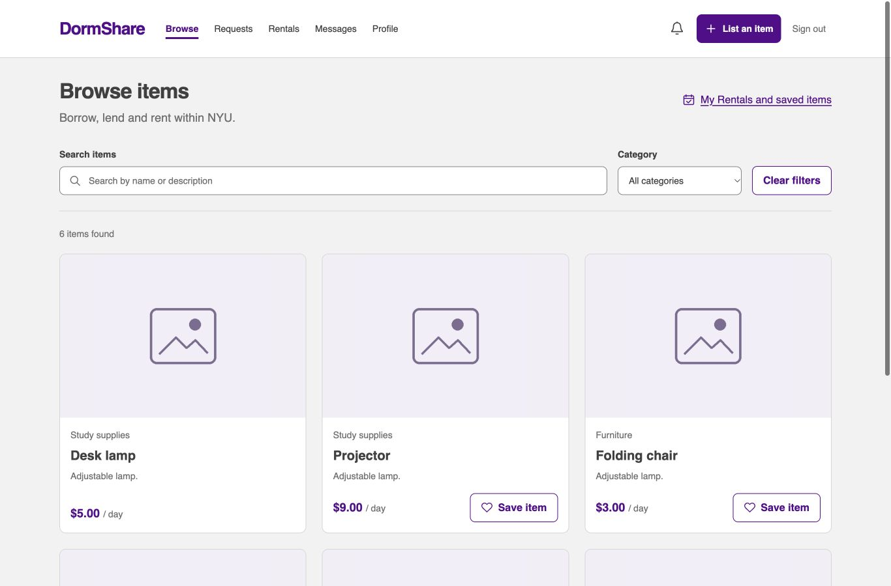
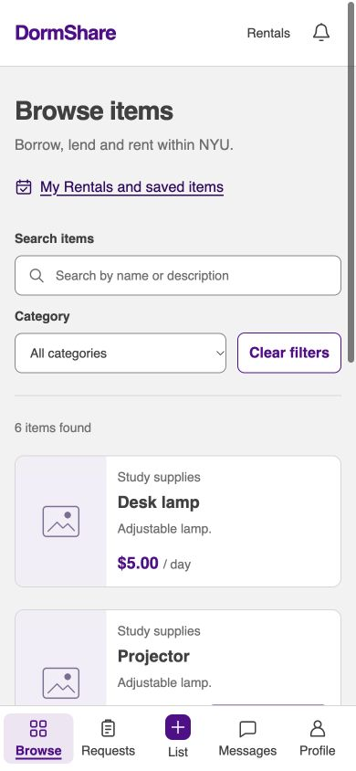
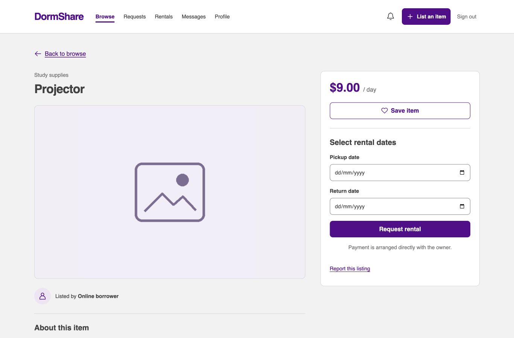

# Discovery redesign verification

Checked November 18, 2026 against a local fixture API. The app uses the real Express routes with synthetic records. No live project records were changed.

## Automated checks

- Frontend lint passes.
- Frontend build passes with 109 modules.
- The full frontend suite has 127 passing tests and one failure in `test/notifications.test.js:202`.
- The same notification test failed before the interface changes. All other 127 tests pass when run separately.
- The focused listing, saved-item, booking, and review checks pass: 43 tests.
- The diff passes whitespace checks.

## Browser checks

These are browser viewport checks, not physical-device tests.

| Width | Browse columns | Browse overflow | Detail overflow |
| --- | --- | --- | --- |
| 320px | 1 | None | None |
| 375px | 1 | None | None |
| 390px | 1 | None | None |
| 768px | 2 | None | None |
| 1024px | 3 | None | None |
| 1366px | 3 | None | None |

The fixture includes a long listing title. It wraps without widening the page. Images use the existing placeholder. Browser inspection confirms the Helvetica/Arial stack and the approved canvas color.

Verified these paths through the interface:

- Sign in, desktop navigation, compact phone header, phone bottom navigation, Profile, and sign out. The phone bar and its bottom clearance disappear after sign out.
- Browse active-page indication and the Browse location marker on Item Details.
- Both review screens show one shared phone bar, with the old duplicate navigation removed.
- Search for Projector, combine it with Furniture for no results, then reset to all six fixture listings.
- Save on Browse and open Details. The saved state remains consistent. A failed unsave preserves that state and displays the error.
- A delayed mutation disables the save control and marks it busy until the request finishes.
- Listing load failure and retry, item load failure and retry, and saved-items failure and retry. Saved controls remain disabled until saved state loads.
- Owned items have no Save, Request rental, or Report action. An unavailable item shows its explanation and return link.
- Required dates, past pickup protection, equal-date rejection, and the valid date estimate. November 19 to 20 produced a one-day estimate of $9 and opened the existing booking form with both dates intact.
- Keyboard Tab reaches the pickup field with a visible 3px violet outline.
- The existing chat offer dialog remains above the new phone bar at 320 by 500px. Cancel is reachable and closes it. The modal uses layer 30; navigation uses layer 20.

All 28 source routes were visited at a 320px viewport, using fixture IDs and query views. Existing account redirects were observed. The missing-report view was observed for the synthetic `DS-999` URL. Quick Borrow still renders its existing form outside a `main` element. This check does not claim every feature flow or accessibility criterion was audited.

The requests-board tabs still overflow at 320px. The unchanged baseline measured 355px of content width; this branch measured 349px. It is an existing issue for #146 and #148, not a new discovery-layout regression. Full cross-app mobile, zoom, and assistive-technology checks remain under #148.

## Review

An independent code review and a security review approved the final source changes. The code review prompted the short-screen dialog check. The stacking fix was verified in the browser and reviewed again. There are no remaining findings from those reviews.

## Captures

All captures show synthetic fixture content and the real app UI.

### Browse, desktop

### Browse, phone viewport

### Item Details, desktop

