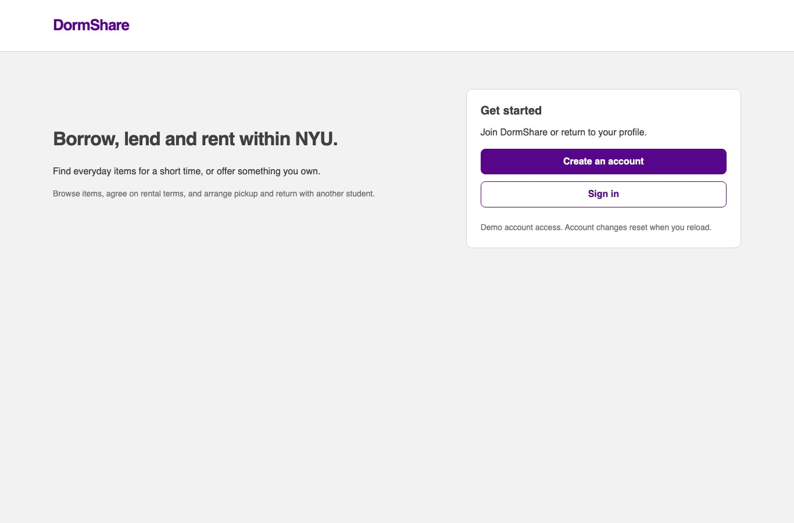
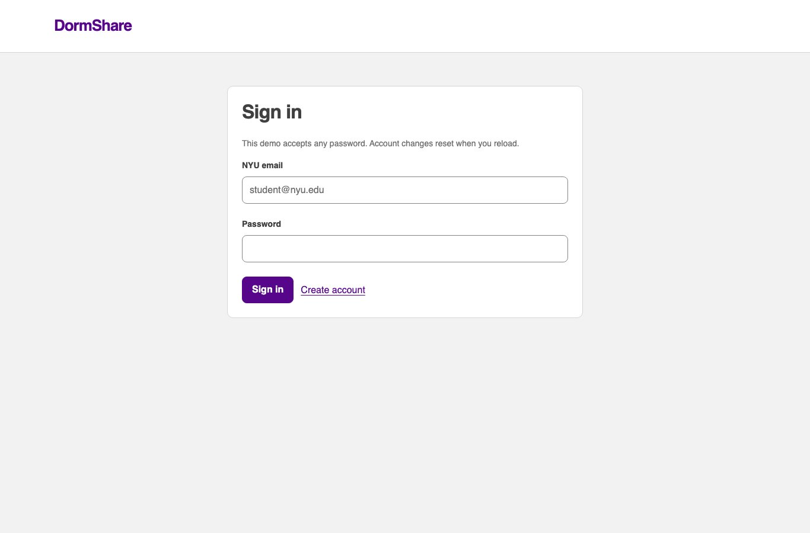
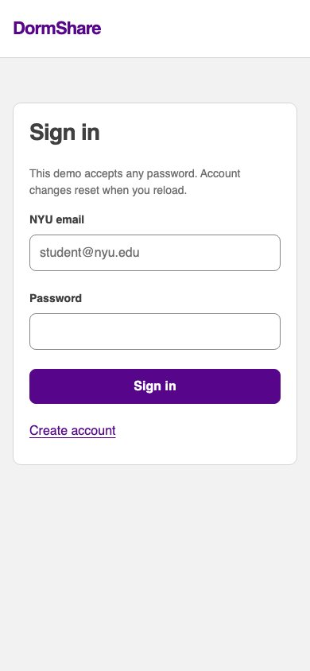
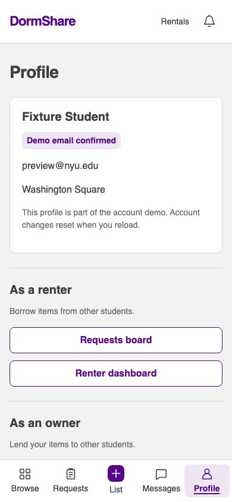
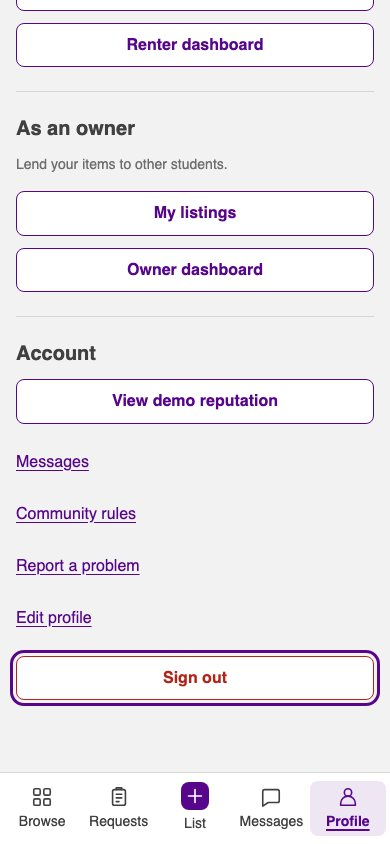

# Account and profile verification

Checked November 20, 2026 on `feature/143-account-styles`, based on master `306fc2a`. The browser used the real app and a local fixture API with synthetic records. No live project records changed.

## Automated checks

- All 128 frontend tests pass, both before and after the account changes.
- Frontend lint and production build pass.
- The diff passes whitespace checks.
- Five focused browser accessibility checks pass. They cover invalid-email state, error association and focus, error clearing without a focus change, password autocomplete, the setup h1, and unsupported Profile copy.

The baseline failed four of these checks: invalid email had no linked error or invalid state, password autocomplete was absent, setup had no h1, and Profile claimed “Verified NYU” plus a fixed completed-rental count. Those checks now pass. The email-edit check also passes after the review fix.

## Browser checks

Headless Chromium checked all six account views at 320, 375, 390, 768, 1024, and 1366px. The fixture used long unbroken display names, email addresses, and campus areas.

| View | Result at every width |
| --- | --- |
| Welcome | No horizontal overflow; one h1 |
| Sign in | No horizontal overflow; one h1 |
| Signup | No horizontal overflow; one h1 |
| Demo email verification | No horizontal overflow; one h1 |
| Profile setup | No horizontal overflow; one h1 |
| Profile | No horizontal overflow; one h1 |

Seven browser test groups passed:

1. Signup keeps native required and eight-character password constraints. Whitespace-only names and non-NYU emails show linked errors, retain values, and focus the affected field. Email normalization and trimming are preserved.
2. Invalid verification codes retain their value and focus. Resend clears the code and error, announces a status, and makes no email-delivery claim. Any six digits still complete the demo. Profile setup rejects whitespace, links both errors, and focuses the first invalid field.
3. Profile editing preserves defaults and updates the same session. Every Profile destination remains intact. Sign-out removes the signed-in navigation. Signing in again with the same email restores the profile within that session. Tab reaches Sign out with a visible 3px focus outline.
4. Signed-out verification and setup redirect to signup; signed-out Profile redirects to sign-in. Unverified setup redirects to verification. Profile shows the email fallback and unconfirmed demo state when appropriate. Reload still clears account state.
5. All six views fit all six widths. Error and help references point to existing elements.
6. All six views fit at 390px with a 200% root font size. At 390 by 500px, setup and Profile final controls can scroll clear of the phone navigation.
7. Profile shared-data failure stays within 320px. Retry opens the signed-in profile. Captures were saved with no uncaught browser errors.

The group names in the browser runner combine related checks. The list above describes their observed coverage.

## Review and existing behavior

Source and security reviews approved the final source at `5a76c87`. The review prompted two fixes: clear the new login invalid state when the email is edited, and show the demo reset notice on setup. Both fixes passed browser regression checks.

Signing out from Profile first requests `/`, then the existing signed-out route guard lands on `/login`. This happened in three runs on unchanged master and three runs on this branch, using real navigation links. It is preserved here and should be considered during #94 account integration.

The account provider, routes, callback arguments, native constraints, validators, and Profile shared-data boundary remain unchanged. Password authentication, email delivery, persistent accounts, and API integration remain in #94. Real recovery and its screens remain in #139.

These are Chromium viewport checks, not physical-phone or screen-reader results. The short viewport approximates reduced keyboard space. Root-font enlargement is not a claim of a true 400% browser zoom test. Physical-device, full zoom, and cross-app checks remain in #148.

## Captures

All account details are synthetic. The Profile controls capture is scrolled to the end to show clearance above the fixed phone navigation.

