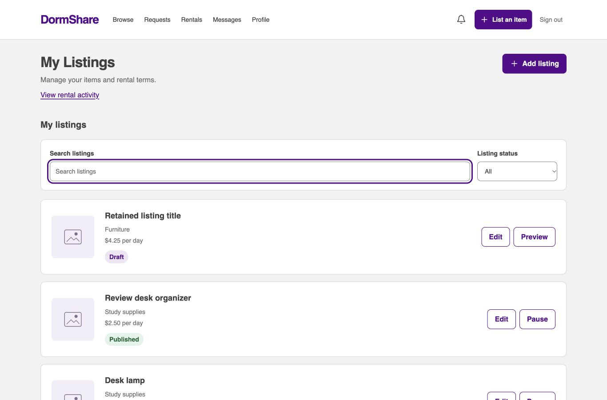
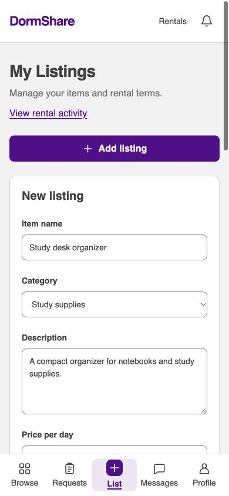
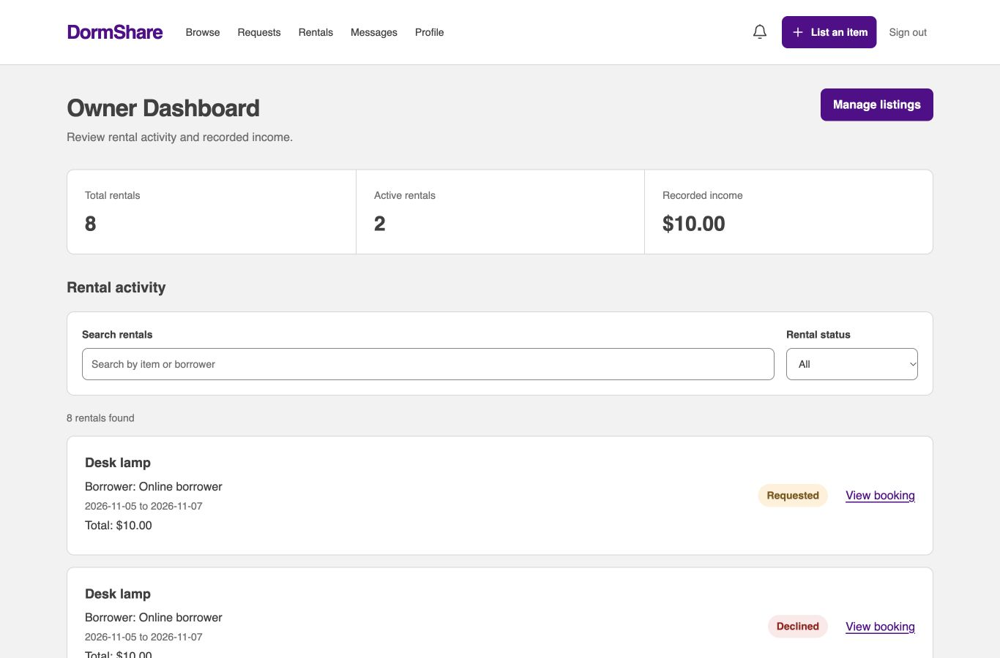
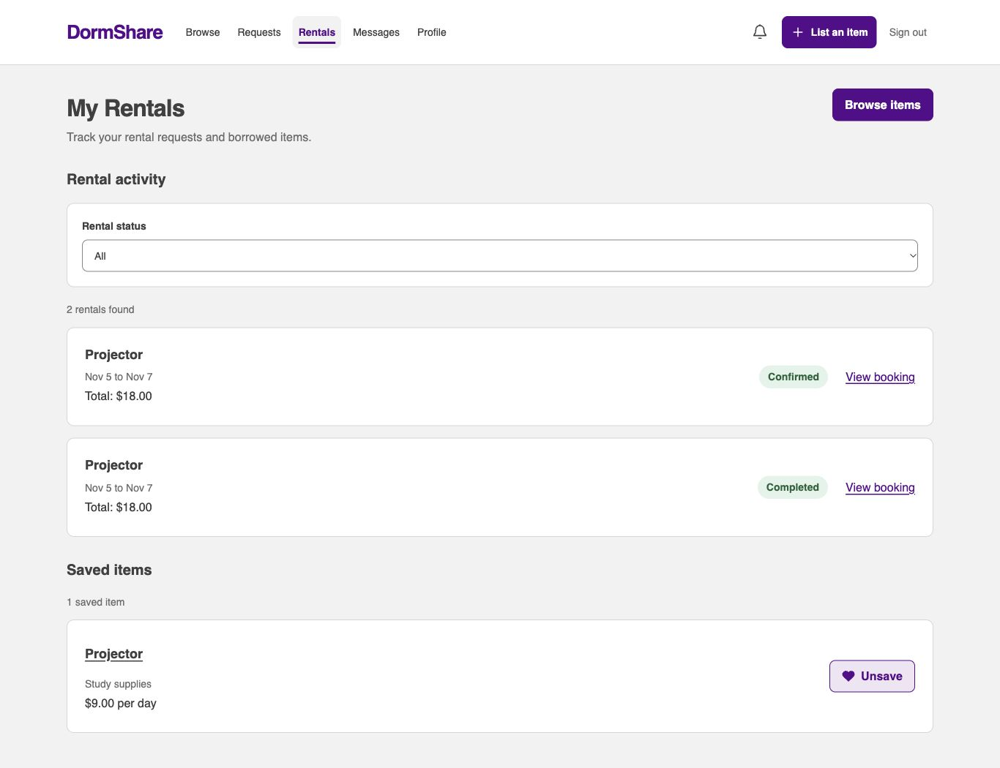

# Listings and dashboard verification

Verified on November 18, 2026 for #144, based on #154 at `cb1c882`. The scope is My Listings, the new/edit form and preview, Owner Dashboard, and My Rentals with saved items. The approved reference is the [NYU redesign specification](2026-11-18-nyu-redesign-design.md).

## Automated checks

| Check | Result |
| --- | --- |
| `npm test` in `front-end` | 130 pass, 1 existing failure |
| All frontend test files except `notifications.test.js` | 130 pass |
| New listing validation tests | 3 pass, including blanks, invalid prices, free and decimal prices |
| `npm run lint` in `front-end` | Pass |
| `npm run build` in `front-end` | Pass, 112 modules |
| `git diff --check` | Pass |

The full suite fails at `test/notifications.test.js:202` with `true !== false`. The same failure was recorded before this change, when 127 tests passed. That file and notification behavior are unchanged. The new validation tests first failed because the helper did not exist, then passed after implementation.

## Browser checks

Used the in-app Chromium browser with a disposable local backend and synthetic listings, rentals, and saved items. Network failures, empty results, and delays were injected in that local fixture only.

| Area | Steps and observed result |
| --- | --- |
| Responsive routes | Checked `/listings`, `/listings/new`, `/owner-dashboard`, and `/renter-dashboard` at 320, 375, 390, 768, 1024, and 1366px. All 24 checks had document width equal to viewport width. Long titles wrapped without hiding actions. |
| Validation | Submitted spaces-only title, description, and terms with a valid category and price. All three fields showed linked errors and invalid state. Focus moved to the first invalid field. |
| Listing workflow | Created a free draft, previewed it, edited the price to $2.50, saved, published, paused, and published again. Preview and list showed each returned state. |
| Listing failures | A failed save kept all entered values and enabled retry. A delayed save disabled submission and marked the form busy. Failed reads showed an alert and recovered through Try again. |
| Listing filters | A search with no matches showed the filtered empty state. Paused status showed the paused listing. Clearing filters restored the list. |
| Owner dashboard | The server summary stayed at 8 total rentals, 2 active rentals, and $10 recorded income while search returned no matches. Clear filters restored eight rows. Failed reads recovered through Try again. |
| Renter dashboard | Completed status showed one rental. Clear filter restored two. Rental and saved-item failures displayed separate retry controls, and each recovered independently. A booking link opened its summary. |
| Saved items | Saving Projector in Browse made it appear in My Rentals. An unsave failure kept the known saved item and displayed feedback. |
| Empty data | No listings, no owner activity, and no renter activity each showed a useful empty state. Saved items remained independent of the rental result. |
| Keyboard and phone clearance | Tab moved from Item name to Category with a 3px violet focus outline. At 390px, the final saved-item button ended at 703px, above the bottom navigation at 772px. Form controls measured at least 44px high. |

Independent source and security reviews passed. The source review found one visible-label mismatch in the listing filter. Removing the old overriding ARIA label fixed it, and the review passed on the updated source.

These checks do not claim physical-device coverage, Safari or Firefox coverage, a screen-reader audit, or a browser zoom audit. Existing service tests cover data and cache contracts. No backend, service, provider, shared base style, or authentication behavior changed.

## Screenshots

All images show synthetic local data. The phone image shows the top of the form; the fields below it were checked separately.

### Listing management, 1366px

### Listing form, 390px

### Owner dashboard, 1366px

### Renter dashboard and saved items, 1366px

