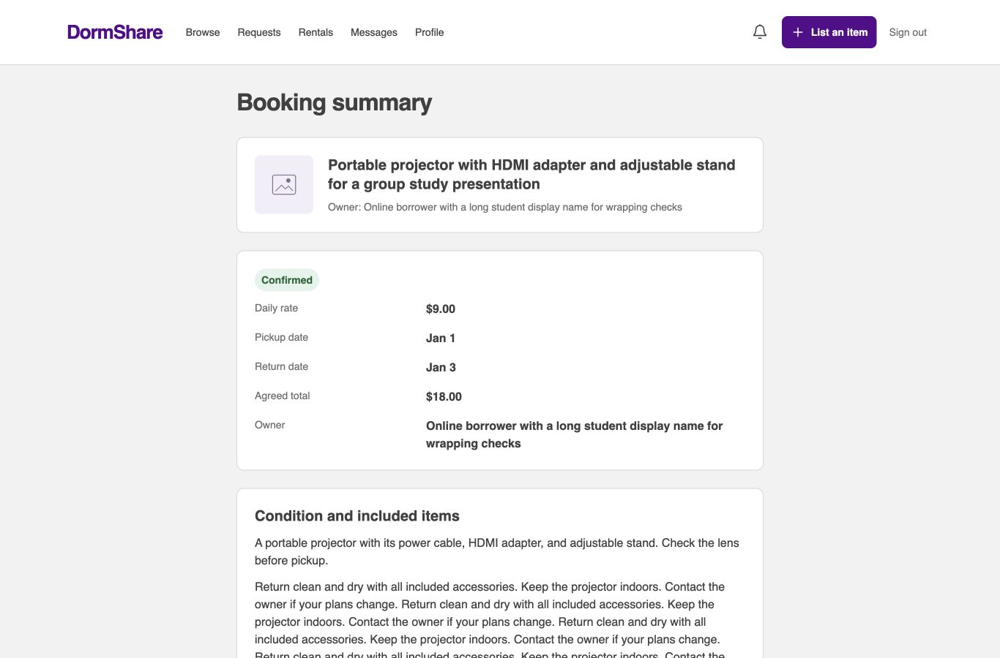
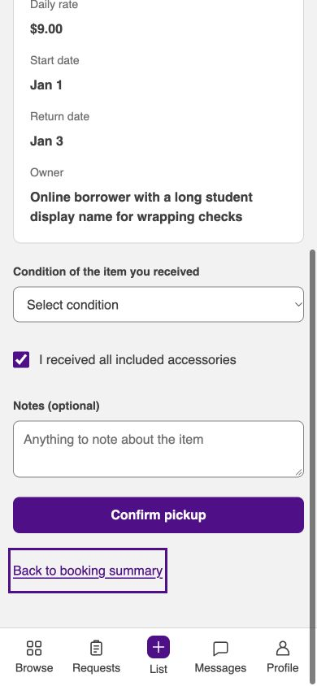

# Booking and handoff verification

Verified November 19, 2026 for #145 against the [approved design](2026-11-18-nyu-redesign-design.md) and [interface contract](145-booking-interface.md). The branch was rebased from #154 onto master at `6c718b6`. The seven implementation commits were unchanged by the rebase, as confirmed by `git range-diff`.

## Automated checks

| Check | Result |
| --- | --- |
| Booking API, extension, cancellation, and handoff tests | 32 pass |
| Frontend tests excluding unchanged notifications file | 127 pass |
| Full frontend suite, including after rebase | 127 pass, 1 existing failure |
| Frontend lint | Pass |
| Frontend production build, including after rebase | Pass, 109 modules |
| `git diff --check` | Pass |

The full suite fails at `test/notifications.test.js:202` with `true !== false`. This same failure was recorded before #145. No notification source or tests were changed. No new data or validation rules were added, so the existing integration and domain tests remain the contract checks. Browser checks below cover the changed presentation and accessible feedback.

## Browser evidence

Used the in-app Chromium browser with a disposable local Express fixture. All records, failures, delays, and mutations were synthetic. No live service data was changed.

| Area | Observed result |
| --- | --- |
| Route and viewport matrix | Checked request, incoming requests, summary, extension, cancellation, and handoff at 320, 375, 390, 768, 1024, and 1366px. Repeated the 36 checks after the final rate/heading change with long participant names. Every route used the new scope and document width equalled viewport width. |
| Date feedback | Before the change, empty request dates had no invalid state, linked descriptions, or error focus. Afterward, both dates had linked errors and focus moved to start date. Extension errors also focused the named date field and cleared on valid native date entry. |
| Request to summary | Query dates February 1 through February 4, 2030 showed $27 for three days at $9. A failed request kept both dates and the message. A delayed retry exposed busy state and disabled Send, then opened the server-created requested booking. |
| Agreed price | Changed a fixture listing price from $5 to $7. The existing booking still showed its saved $5 daily rate and $10 total, with no conflicting current price in its header. |
| Owner confirmation | Confirm was disabled until the agreement checkbox was checked. Confirmation changed the returned status and total label to Confirmed and Agreed total. |
| Incoming requests | A delayed decline disabled its button. A failed decline retained the request and enabled retry. Retrying removed the request. With no pending records, the page explained the empty state and linked to listing management. |
| Extensions | The borrower submitted a later date and saw the waiting state. Owner approval moved the return date and total from $10 to $25. In a fresh fixture, decline preserved the original date and $10 total. |
| Cancellation | Withdrawing a requested rental showed the cancellation result. Cancelling a confirmed rental required the existing confirmation page. Active rentals explained why cancellation was unavailable. |
| Local handoff | Tab and Space operated the native accessory checkbox. Pickup recorded condition, accessories, and notes and opened an Active summary. Return recorded a missing accessory without rejection and showed Rental complete. Following the summary link retained each local update. These actions remain browser state, not server persistence. |
| Other states | Overdue had explicit text and status. A missing booking showed a useful recovery link. Own-listing requests stayed blocked. A failed booking read showed Retry and recovered to the correct booking. |
| Phone controls | The old 288px-wide checkbox at 320px became a 20px native checkbox with a flex label. At 390px, the final handoff link ended at 724px, above navigation starting at 772px. Long fields and names wrapped. |
| Profile isolation | Signed-in Profile stayed outside `.ds-booking` and retained its legacy 560px width. The legacy booking and handoff stylesheets were not rewritten. |

Independent source and security reviews approved the final source. The source review found a missing saved daily rate and an extension heading-level mismatch. Both were fixed and re-reviewed before completion.

These checks do not claim physical-device coverage, Safari or Firefox testing, a screen-reader audit, or a browser zoom audit. Pickup and return integration remains in #113. Frontend account integration remains in #94. The current service identity and all booking helper names and contracts are unchanged.

## Screenshots

The desktop view shows the top of a summary with long content. The phone view shows the handoff controls and the clearance above navigation. Both use synthetic records.

