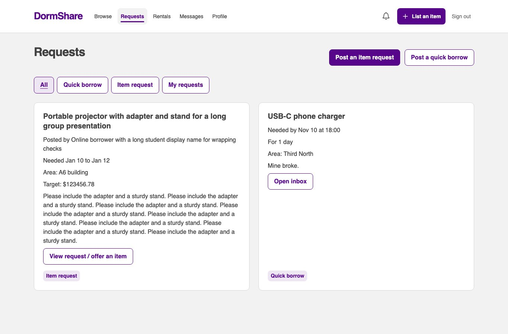
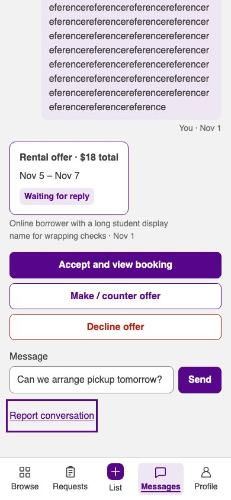
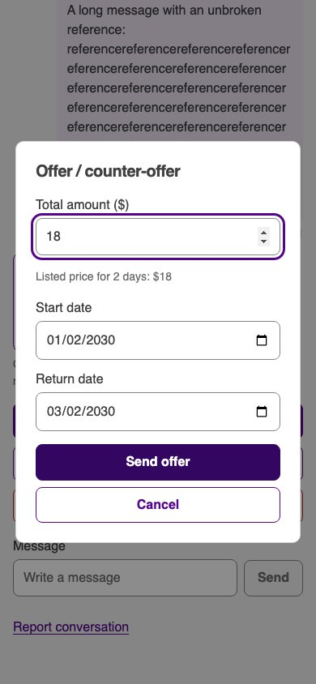

# Messages and requests verification

Checked November 19, 2026 on `feature/146-messages-styles`, based on master at `6c718b6`. The browser used the real app and Express routes with synthetic fixture records. No live project data changed.

## Automated checks

- Frontend lint and production build pass.
- The focused item request, requests board, and booking API tests pass: 22 tests.
- The full frontend suite has 127 passes and one failure at `test/notifications.test.js:202`. The same notification assertion failed before these changes. Its test clock fix is in #159.
- All 127 tests outside the notification file pass when run separately.
- The diff passes whitespace checks.

## Browser checks

Headless Chromium checked all six views at 320, 375, 390, 768, 1024, and 1366px:

| View | Result at every width |
| --- | --- |
| `/inbox` | No horizontal overflow |
| `/inbox?conversation=1` | No horizontal overflow |
| `/requests?new` | No horizontal overflow |
| `/requests?request=1` | No horizontal overflow |
| `/requests-board` | No horizontal overflow |
| `/quick-borrow` | No horizontal overflow |

The fixture includes long titles, a long student name, an unbroken message, and a $123,456.78 target price. The old requests board measured 349px at a 320px viewport. It now fits within 320px.

Nine browser test groups passed:

1. The six views at the six widths above.
2. Board filters, invalid request feedback, first-error focus, request creation with an optional blank price, My requests, and closing an owned request.
3. Message-only responses and free offers open the correct conversation.
4. Sending a message clears its draft. The offer dialog has an accessible name, focuses the amount field, contains Tab and Shift+Tab, and focuses the first invalid field. Escape, Cancel, and a backdrop click restore focus to the opener. A drag from inside the form to the backdrop preserves the draft.
5. A counteroffer replaces the previous offer. Decline updates its status. Accept opens the existing local booking summary. An offer from the current user has no accept action.
6. Quick Borrow rejects whitespace, focuses its error, saves valid data, resets after success, and remains visible under My requests after a reload.
7. A simulated localStorage write failure shows an error and retains all form values. It shows no success message.
8. Missing and empty conversations and requests have recovery text. The response view handles having no published listing to offer.
9. The signed-in phone composer clears the bottom navigation at the end of the page. The offer dialog fits within a 390 by 500px viewport and its actions can be reached by scrolling. Desktop and phone captures show the real interface.

Separate checks at 320px also passed for shared data load failure and retry on Inbox, new request, request detail, and the board. The error view stayed within the viewport, and retry opened each view.

## Review and limits

Source and security reviews approved the final source at `185e8cf`. Review found that dragging from an offer field to the backdrop could discard its draft. The fix requires both the initial pointer press and click to be outside the dialog. The browser regression passed. The Quick Borrow link now says “Open inbox” to match its existing destination.

These checks use browser viewports. They do not verify a physical phone keyboard, a screen reader, or every browser. The short viewport is only an approximation of reduced keyboard space. Full cross-app mobile and zoom checks remain under #148.

Chat and item request mutations still use the existing in-memory services. Quick Borrow still saves in this browser. These changes do not connect new APIs or promise server persistence. The separate API work remains in #104, #109, and #115.

## Captures

All records in these images are synthetic.

