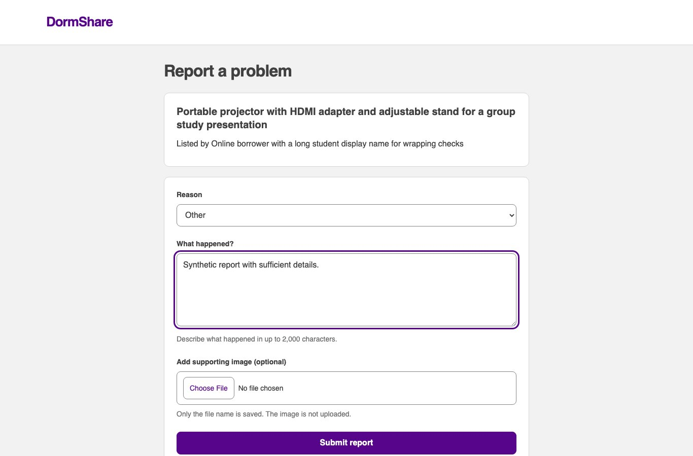
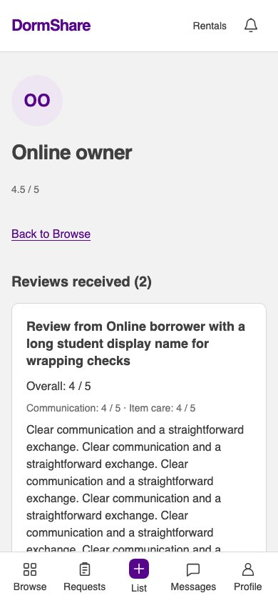
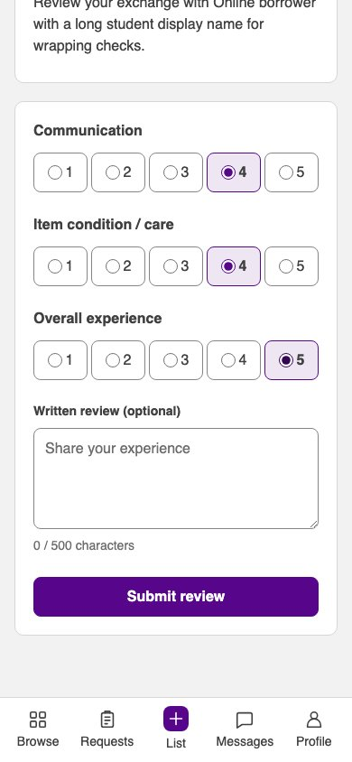

# Notifications and trust verification

Verified for #147 on November 19, 2026. Base: master at `6c718b6`. The [interface contract](147-trust-interface.md) and [implementation plan](147-trust-plan.md) define the scope. The remaining browser flows and final source re-review are complete.

## Automated checks

| Check | Result |
| --- | --- |
| Full frontend suite on the final source | 128 pass, 0 fail |
| Notification, review, and reporting tests | 11 pass |
| Frontend lint | Pass |
| Frontend production build | Pass, 110 modules |
| Diff whitespace check | Pass |

The prior notification failure at `test/notifications.test.js:202` was reproduced in isolation. Its fixture return date had passed, so the bulk-read step marked the overdue notification as read before the later regression scenario reused that same ID. Freezing Date at November 6, 2026 keeps the intended reminder-to-overdue transition deterministic. The complete test then passes with all original assertions intact. No notification service behavior changed.

The final full suite initially could not start loopback servers under the restricted test environment. It was rerun with loopback access and all 128 tests passed.

## Completed browser checks

Used the in-app Chromium browser with a disposable local Express fixture. All names, comments, reports, and mutations were synthetic.

- Checked Notifications, Reputation, Review Participant, Report, Report Submitted, and Community Rules at 320, 375, 390, 768, 1024, and 1366px. All 36 checks used the new trust scope and document width equalled viewport width.
- Checked a long participant name, long review comments, and a long listing title. Content wrapped without page-level overflow in the route matrix.
- The review form now has a page h1. At 320px, each of the first five rating labels measured 46px wide and 44px high. Before the change, labels were about 33px wide and 21px high.
- Marking a notification read reduced Unread from 12 to 11. Unread filtering excluded that notification. Marking it unread restored it.
- Mark all as read produced an Unread count of zero, the caught-up state, and a disabled bulk action. The zero count survived refresh. View details for New rental request opened `/bookings/101`.
- A report with a valid reason and spaces-only description showed a linked error, set `aria-invalid`, and focused the description. Changing the reason retained that description error. Correcting the description cleared it.
- A failed report submission retained its reason and description and enabled submission again.

The initial checks used the in-app browser. The final checks used a fresh headless Chromium session through Playwright 1.61.1 against the same disposable fixture. No personal browser profile or live data was used. Screenshots below were saved and inspected.

## Review status

The independent security review passed and also ran the 11 targeted frontend tests and 61 backend reporting tests. The source review raised two findings: unrelated field edits cleared description feedback, and the report-confirmation loading branch lacked a heading. Both were fixed in `11e998f`. The error-retention fix was checked in the browser. The loading branch was checked in source. The final independent source re-review approved `ade3a49`, confirming both fixes. No application source changed after that review.

## Final browser checks

All ten scenario groups passed in the local Playwright run.

| Area | Observed result |
| --- | --- |
| Reviews | Required native ratings blocked empty submission. Space selected a rating and ArrowRight changed it. Submission opened the other participant's reputation and displayed the comment. Returning within the app showed the duplicate guard. Missing and incomplete bookings stayed ineligible. |
| Reputation | Missing users showed the recovery heading. The other student's empty reviews and unrated state rendered correctly. The published-listing toggle showed and hid the controlled section. |
| Report contexts | General, rental, conversation, direct listing, and unknown-rental-with-known-listing forms sent the existing six-field JSON payload. Each saved report opened confirmation and retained its exact related destination after a direct reload. |
| Report errors and pending | A whitespace description stayed invalid after selecting a file. Correcting it cleared the linked error. A rejected write retained reason, description, and selected filename. Delayed retry disabled submission and set busy state, then succeeded with only the filename in the JSON payload. |
| Conflicting subjects | Conflicting known rental and conversation references were rejected by the backend. The form retained its description and showed the existing error. |
| Read recovery | Rules recovered from a read failure, handled empty data, and retried to populated data. Missing reports showed not found. A failed confirmation read exposed retry, a loading heading and status, then the saved report. |
| Stale response | A delayed confirmation response for one report did not replace the not-found result after navigating to another report. |
| Empty notifications | Empty activity produced the no-notifications state and disabled bulk read. |
| Reflow and text | Repeated the six routes at all six planned widths with no page-level overflow. All six also fit a 390px viewport with the root font size set to 200%. This is a text-size check, not a browser-zoom claim. |
| Phone navigation | The signed-in review submit button remained fully above the fixed phone navigation. Native rating labels remained visible and usable. |

## Screenshots

All records are synthetic. The desktop report shows its subject, form, and filename-only explanation. The phone images show reputation and review controls, including the space above navigation.

Review and notification changes still use local state and existing services. Report and rule requests still use the existing backend APIs. No service, identity, route, API payload, or eligibility contract was changed. This report does not claim physical-device, Safari, Firefox, screen-reader, or zoom coverage.
