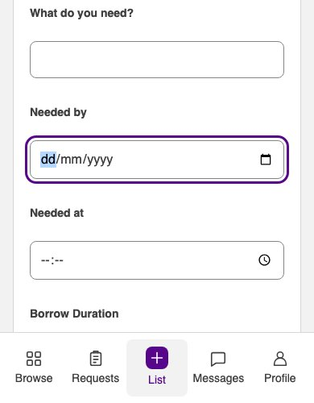
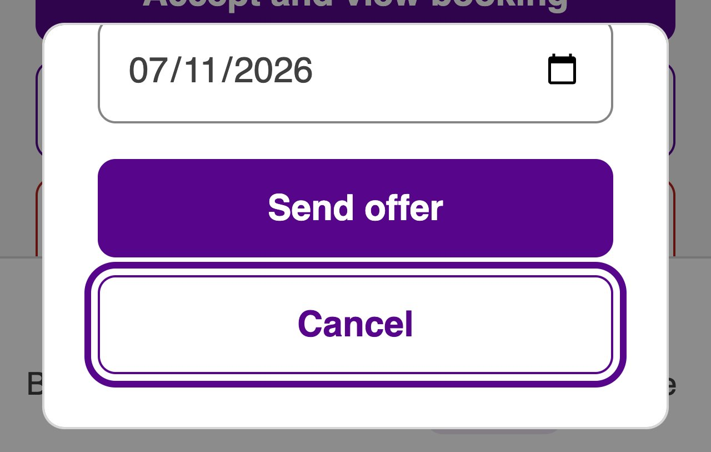

# Final merged-app verification

Checked November 20, 2026 for #148 and #141 against master `9e83b384f9003967cf7e255e748d5dae47c8eff0`. PRs #157, #163, and #164 are merged. Local master tracks `origin/master` and is synced with that commit.

This pass uses the actual merged frontend and Express app with synthetic fixtures on loopback servers. It changes no application code, dependencies, API contracts, or live project records. The frontend source is identical to the earlier combined audit version with the shared focus fix applied. The account, messaging, and requests components used for the phone checks have not changed.

## Fresh results

| Check | Result |
| --- | --- |
| Frontend test suite | 131 pass, zero failures |
| Frontend lint and production build | Pass |
| Layout matrix | 210 pass across 35 views at 320/375/390/768/1024/1366px |
| Actual 400% Chromium tab zoom | All 35 views pass |
| 200% root-font enlargement | All 35 views pass at 320 and 390px |
| Focus regression | 324 observations pass, including 288 after native Tab or Shift+Tab |
| Journey test groups | 33 pass: account 7, messages/requests 9, trust 10, other journeys 7 |
| Uncaught errors in the three layout matrices | Zero |

The [route checklist](148-route-checklist.md) covers all 28 explicit routes and seven extra query or role views. [Machine-readable counts and journey names](148-merged-checks.json) record these fresh results. The [earlier report](148-verification.md) explains reproduction steps, fixture states, and journey coverage.

The merged version has no long-name Profile overflow in the tested matrix. The native focus regression records zero fully obscured controls across six affected routes at 320 by 500, 390 by 500, and 320 by 203px. Large textareas can be partly visible while the entry line and focus outline remain above the phone bar. These results do not claim full-frame textarea visibility.

The actual tab zoom changed a 1280 by 813px content viewport to 320 by 203px, with device pixel ratio changing from 1 to 4. The browser reported zoom 4, subject to floating-point rounding. The offer dialog scrolled to Send offer and Cancel. Keyboard focus stayed inside it, and Escape returned focus to its opener. This check is separate from phone viewport emulation and root-font enlargement.

## Physical Safari evidence

The user already supplied iPhone Safari screenshots for Welcome, Browse, Profile, Requests, the message keyboard, and a successfully sent message. The user also confirmed a usable offer dialog, successful Quick Borrow submission with the keyboard open, and working Requests and Quick Borrow forms in landscape without sideways page scrolling.

Those are prior user observations on the combined preview. The phone screenshots preceded the shared focus fix. That CSS fix was verified separately in Chromium, while the tested journey components remain unchanged. This pass did not repeat the physical-device run. The model and iOS version were not supplied. Original phone images remain local. The installed automated WebKit runner could not load the fixture, so no automated Safari result is claimed.

## Completion and limits

The required final merged-version checks pass. No additional product fix was found. The redesign slices and mobile audit are complete for the recorded scope of #141 and #148.

This is a regression record, not an accessibility conformance certificate or a broad screen-reader audit. Existing demo account behavior and local chat, request, handoff, and review services retain their current limits. Real password recovery remains in #139 and account API connection remains in #94. Neither is claimed as delivered by the styling work.

## Fresh captures

Synthetic fixture content only.

