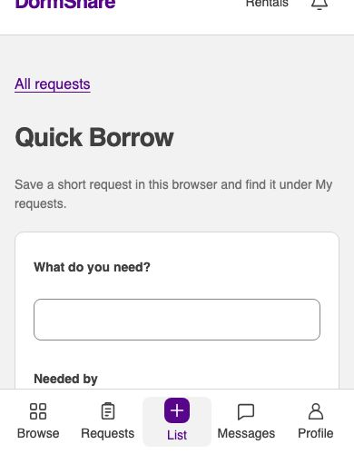
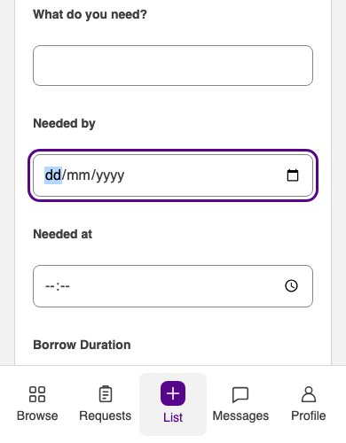
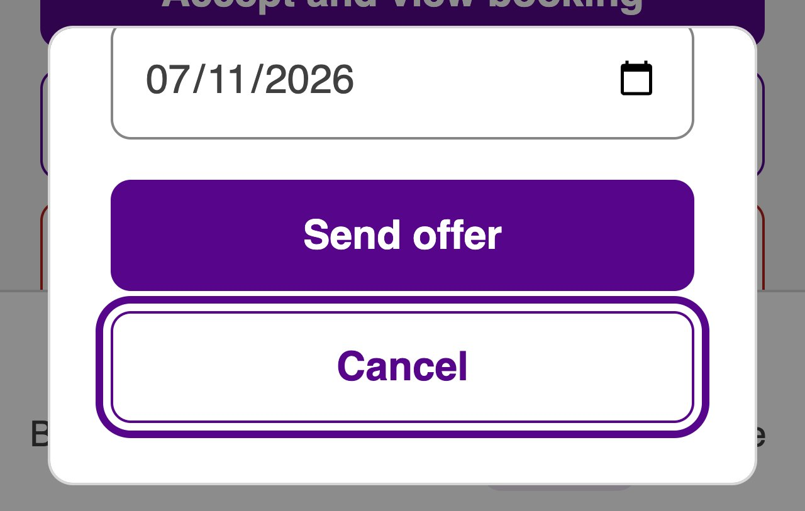

# Cross-app mobile verification

Checked November 20, 2026 for #148. The app used local Express routes and synthetic fixtures. No live project records changed. This report is a regression record, not an accessibility conformance certificate.

## Versions and results

Master was `306fc2a`. The temporary combined checkout was `c94a69e`, containing pending dashboard PR #157 at `c6e3d9d` and account PR #163 at `2454678`. The combined tests then used this branch's shared CSS fix. Those pending changes are not included in this PR.

| Check | Result |
| --- | --- |
| Fix branch frontend tests | 128 pass |
| Combined frontend tests | 131 pass |
| Lint and production build | Pass on both versions |
| Combined layout matrix | 210 passes: 35 views at six widths |
| Actual 400% Chromium tab zoom | All 35 views pass layout checks |
| 200% root-font enlargement | All 35 views pass at 320 and 390px |
| Focus regression | 324 observations pass, including 288 observations after native Tab or Shift+Tab |
| Journey test groups | 33 pass across the four groups below |
| Uncaught errors in the main layout matrix | None |

The widths were 320, 375, 390, 768, 1024, and 1366px. The [route checklist](148-route-checklist.md) names all 28 explicit routes and seven extra query or role views. [Recorded counts and zoom geometry](148-checks.json) preserve the version references.

Current master has six long-name Profile overflow results, one per tested width. At 320px the document reached 1580px. Pending #163 fixes those results in the combined checkout. This branch does not duplicate that account work. Final verification against merged master remains outstanding while #157 and #163 are open.

## Confirmed focus defect and fix

At 390 by 500px, native Tab focused Quick Borrow's Needed by field at y=451.59 through 499.59. The fixed phone bar started at y=427.81, completely covering it. Related observations occurred in listing creation, reporting, chat, booking, and reviews. The full forward/backward baseline regression recorded 49 fully obscured focus observations. These are observations, not 49 distinct bugs.

At 320px, wrapped navigation labels also made the bar 87.375px tall while its height token reserved only 72px. The fix gives the bar and page reserve one 5.5rem height contract and adds document scroll padding for the bar, safe area, and 16px clearance. It applies only to phone layouts that contain the signed-in bar. Desktop and signed-out scroll padding stay unchanged.

The regression now records zero fully obscured controls on both the fix branch and combined version. It traverses six affected views in both directions at 320 by 500, 390 by 500, and 320 by 203px. Date/time segments and native radio traversal remain native. The [runnable check](../../front-end/test/browser/mobile-focus.mjs) and [instructions](../../front-end/test/browser/README.md) use disposable fixture servers without adding a project dependency.

The initial screenshot and final capture use the same 390 by 500px size. In the final capture the date field is y=173.59 through 221.59, above the bar at y=412.

The focus test establishes that controls have a visible portion above the bar. It does not require every large textarea border to fit at once. Two forward-focus observations left a listing textarea partly beneath the bar while its first entry line and upper focus outline were visible. A separate seven-line typing check kept the caret above the bar through native scrolling. Full-frame textarea visibility and complete screen-reader behavior are not claimed.

## Journey checks

| Group | Observed coverage |
| --- | --- |
| Account, seven groups | Signup native/custom validation, six-digit demo verification, resend status, setup errors, profile editing, links, sign-out, same-session reuse, guards, reload reset, long values, and shared-data failure/retry. |
| Messages and requests, nine groups | Send/reset, offer validation, Tab and Shift+Tab, Escape/Cancel/backdrop/focus return, drag draft preservation, counteroffer, decline, local acceptance to booking, request create/reply/free offer/close, board filters, missing/empty data, Quick Borrow persistence and storage failure. |
| Trust, ten groups | Native required ratings and arrow keys, review creation/duplicate guard, eligibility, reputation toggle, report subjects and exact return links, validation, pending and failed submission with file selection retained, retry, stale responses, rules, and empty notifications. |
| Other journeys, seven groups | Discovery search, saved state across My Rentals, date estimate and booking prefill; listing failed save, pending retry, preview, publish/pause/edit; owner filter totals, empty results and booking link; booking retained-error retry and withdrawal; agreement-gated owner confirmation and both extension roles; local pickup and return; notification read state, filters, bulk action and refresh persistence. |

The listing, booking, saved-item, and reporting journeys used their existing API routes. Chat, requests, handoff, and review behavior still uses the existing local services. Tests do not imply a new persistence or authentication contract.

## Full-page zoom

The method follows [NYU's reflow testing guidance](https://digitalaccessibility.nyu.edu/testing/sc1410.html). A temporary extension used the [Chromium tabs zoom API](https://developer.chrome.com/docs/extensions/reference/api/tabs#method-setZoom), with the [documented Playwright extension setup](https://playwright.dev/docs/chrome-extensions).

Before zoom, the content viewport measured 1280 by 813px in a 1280 by 900px browser window, with device pixel ratio 1. The tab zoom API reported 4.0, rounded from floating-point representation. After zoom, the viewport measured 320 by 203px and device pixel ratio 4. All 35 views remained within the document width. This was full-page tab zoom, separate from root-font enlargement and phone viewport emulation.

At that zoom, the offer dialog stayed inside the viewport and scrolled to both final actions. Keyboard focus stayed inside the dialog. Escape closed it and returned focus to its opener. The capture below shows the reachable Send offer and Cancel actions.

## Physical iPhone Safari evidence

The user opened the combined preview on an actual iPhone in Safari and supplied screenshots. The model and iOS version were not supplied. The original phone images remain local and are not included in this PR.

| Supplied image | Visible evidence |
| --- | --- |
| `IMG_4489.PNG` | Welcome introduction and account actions fit the phone width. |
| `IMG_4490.PNG` | Browse filters, item card, and phone navigation fit. |
| `IMG_4491.PNG`, `IMG_4495.PNG` | Request actions and filters wrap; item and Quick Borrow cards remain readable. |
| `IMG_4492.PNG` | Profile renter, owner, and account tools stack with usable labels. |
| `IMG_4493.PNG` | The message field, typed text, and Send action are visible while the real on-screen keyboard is open. |
| `IMG_4494.PNG` | The sent Test message appears in the conversation. |

These images were supplied before the shared scroll fix. They establish those visible device observations, not every requested interaction. The user later confirmed that the offer dialog worked. The user also confirmed that Quick Borrow's Save request button was visible with the keyboard open and saved successfully. The Quick borrow board tab lists existing requests; the form opens through Post a quick borrow or `/quick-borrow`.

Landscape behavior remains unconfirmed. The device confirmations above are user-reported results, separate from the screenshots and automated checks.

The additional installed WebKit runner could not load even the local health endpoint. No automated WebKit result is claimed. The physical Safari evidence above is separate from that runner limitation.

## Review and remaining work

Independent source and security reviews approved the final source at `0016168`. Source review prompted precise separation of programmatic starting positions from native keyboard observations, plus pinned links for reports in the pending PRs. Both findings are resolved.

Keep #148 open for the final merged-version audit after #157 and #163 land, the remaining device confirmations, and any fixes those checks reveal. A broad screen-reader audit is outside these results. Real password recovery remains in #139; account API integration remains in #94.

## Captures

Synthetic fixture content only.

