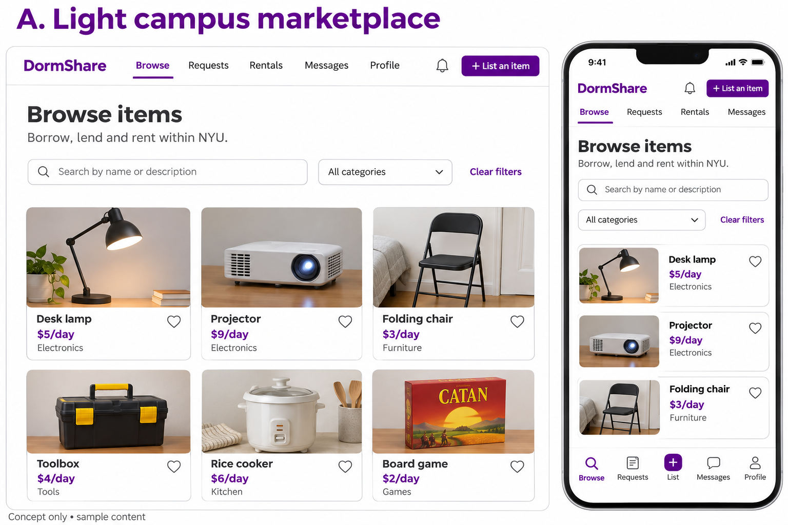

# NYU-inspired DormShare redesign

Prepared November 18, 2026 for #140 and #141. Direction A is selected. This written plan is ready for owner review before implementation begins.

## Goal and scope

Make DormShare feel like one usable student marketplace across phone and desktop. Cover all 28 current routes, their child views, and their feedback states. The first implementation slice is #142. The remaining page groups stay separate under #143 through #147.

Preserve current routes, query parameters, account behavior, API payloads, stored enums, cache updates, price and date rules, and role-based actions. The current source audit is at commit `e928be8`. It records which features still depend on browser state. This redesign does not complete those separate data migrations.

References: [product context](../../PRODUCT.md), [NYU brand research](../research/nyu-brand-guidelines.md), and [route inventory](../research/redesign-route-inventory.md).

## Selected visual direction

The owner chose A after comparing both concepts. Its white header and open catalog give the items more space. B used a violet header and a category rail, leaving less room for results. Both kept the same product features.

The illustration establishes the visual direction. Item images, prices, and categories are sample content. Implementation uses real service records, existing category values, and the current image fallback. Adding real image upload is separate work.

The final phone navigation has one bottom bar. It does not repeat the Browse, Requests, and Messages destinations in another tab row. Rentals and Notifications remain available in the compact header.

The [alternative concept](concepts/violet-campus-hub.png) remains available for comparison.

## Shared design system

### Colors

| Role | Value | Use |
| --- | --- | --- |
| Primary action and link | `#57068C` | Main buttons, selected links, and focus |
| Primary hover and pressed | `#330662` | Interactive action states |
| Selected surface | `#EEE6F3` | Selected navigation and filters with text cues |
| Optional accent | `#8900E1` | Sparse emphasis |
| Body text | `#404040` | Content, labels, and essential metadata |
| Secondary text | `#6D6D6D` | Metadata on white or light gray |
| Page background | `#F2F2F2` | App canvas |
| Content surface | `#FFFFFF` | Header, forms, and item surfaces |
| Decorative divider | `#D6D6D6` | Separators that do not define a required control boundary |

These colors come from the official palette. Assigning them to interface roles is a DormShare design choice. Semantic errors can use `#B42318`, and success messages can use `#166534`. These two colors are project choices. Always include text or an icon with a readable label.

Computed contrast pairs: white on Violet 11.60:1; body text on white 10.37:1; body text on Light Gray 9.26:1; secondary text on white 5.17:1; secondary text on Light Gray 4.62:1; Violet on Light Violet 2 9.53:1. These calculations do not replace browser checks of the final rendered controls.

Normal text must reach 4.5:1. Large text and meaningful non-text control boundaries must reach 3:1. Lighter decorative separators must not be the only way to identify an input. See [WCAG contrast minimum](https://www.w3.org/TR/WCAG22/#contrast-minimum) and [non-text contrast](https://www.w3.org/TR/WCAG22/#non-text-contrast).

### Font plan

Start with one shared font family token using `Helvetica, Arial, sans-serif`. This choice makes the first implementation independent of font access requests. Do not bundle Perstare files until the project has the required website access. Once suitable assets are available, replace the family token and recheck text wrapping, form widths, and layout shifts.

Use 16px body text with a 1.5 line height. Use 14px for compact labels and metadata, 20px for section headings, and 32px for desktop page headings. Phone page headings use 28px. Keep body paragraphs around 65 to 75 characters per line. Controls inherit the body font. Use regular and bold weights rather than adding another family.

These sizes and the fallback are project decisions. Perstare and its access process are documented in [NYU Typefaces and Fonts](https://www.nyu.edu/employees/resources-and-services/media-and-communications/nyu-brand-guidelines/designing-in-our-style/typefaces-and-fonts.html).

### Spacing and responsive layout

Use a small shared spacing scale: 4, 8, 12, 16, 24, 32, 48, and 64px. Use 16px phone page gutters, 24px tablet gutters, and 32px desktop gutters. Cap wide content at 1184px. Keep forms near 600px where useful, and keep reading layouts near 720px. Narrow content should still sit within the same shell and heading system.

Use an 8px base control radius and restrained 10px content corners. Prefer thin borders and whitespace to repeated shadows. Buttons and inputs have a comfortable 44px minimum height as a project touch target. Do not apply that height or full-width input rules to checkboxes and radios.

Use 768px and 1024px as initial layout breakpoints. Browse uses one column on phones, two on medium screens, and three on wide screens when the content fits. Forms, filters, actions, dates, and dashboard rows wrap or stack when they need room. Do not hide overflow to conceal layout problems. Use the mobile safe area and reserve space for the bottom navigation.

Exact values are DormShare choices. Verify the result at 320, 375, 390, 768, 1024, and 1366px, as well as enlarged text. NYU's [reflow standard](https://digitalaccessibility.nyu.edu/testing/sc1410.html) also calls for the 320 CSS pixel equivalent, including 1280px at 400% zoom.

### Navigation

Desktop: a white header with the DormShare wordmark, Browse, Requests, Rentals, Messages, Profile, Notifications, and the main List an item action. Profile provides owner tools, My Listings, and reputation. Highlight the current destination with both color and another cue.

Phone: a compact white header with the DormShare wordmark, Notifications, and Rentals. The single bottom navigation contains Browse, Requests, List, Messages, and Profile. List opens the existing new-listing route. Keep current labels and navigation destinations consistent across review pages and the global header.

Use real links with accessible names. Show signed-in and signed-out actions from the existing account context. This is a navigation treatment, not an authentication or authorization change.

## Components and state behavior

Use the existing components where possible. Establish shared styles for page containers and headings, buttons, fields, alerts, statuses, and feedback. Add a small React component only where repeated markup or behavior makes it useful. No new UI framework is needed.

| Pattern | Contract |
| --- | --- |
| Buttons and links | Default, hover, focus, pressed, disabled, and pending. Keep descriptive names and a visible focus ring. Links remain links. |
| Fields | Visible label, optional help, current value, field error, and invalid state. Keep existing required, date, price, length, and domain rules. |
| Async content | Preserve each service's loading, populated, empty, error, and retry states. Keep existing response ordering guards. |
| Saved items | Preserve shared provider state and per-item pending protection. Save or unsave failure remains visible without losing the known saved state. |
| Rental statuses | Preserve all stored states and derived overdue. Pair status color with words. Keep owner and borrower actions conditional on the existing rules. |
| Forms | Retain values after a recoverable failure. Prevent duplicate submission through the existing pending state. Keep error messages close to the relevant task. |
| Dialogs | Use a semantic dialog with focus entry, contained keyboard focus, Escape handling where appropriate, scrolling, and focus return. Apply this when migrating the offer form in #146. |
| Feedback | Use in-page messages for errors and recovery. Preserve existing live-region behavior. Avoid adding a toast system for the redesign. |

The first slice only extracts patterns used by the shell, Browse, and Item Details. Later slices extend the same system through their actual screens. Do not build unused abstractions upfront.

### CSS migration

Introduce shared color, font, and spacing variables. Scope interactive styles to the controls or components that use them. Avoid new broad rules for every button, input, card, or heading. The current global listing and rental card selectors are reused by several journeys, so changing them requires checks beyond Browse.

Replace page-specific hardcoded colors and duplicated controls as each journey migrates. Keep the page styles that have not migrated yet working with the shared header and base typography. Do not make the whole app depend on one large stylesheet rewrite.

## Data and integration boundaries

The shared API helper remains the network entry point. Keep service function names, formatter helpers, payloads, response handling, and cache hydration intact. A visual refresh must not replace these with new mock data or pretend a local-only operation has server delivery guarantees.

Preserve the pathless MockData and SavedItemsProvider boundaries. Keep current form callbacks, query-driven views, local-only booking identifiers, and stale-response guards. Reuse the existing image placeholder when a record has no supported image source.

Account, chat, handoff, notifications, Quick Borrow, and reviews still have integration work outside the visual redesign. Verify the version that has landed before migrating each page group. Do not change route access or invent verified-account badges as part of styling.

## Delivery sequence

| Issue | Coverage | Dependency |
| --- | --- | --- |
| #142 | Shared foundation, Browse, Item Details, and feedback patterns used by them | Approved written design |
| #143 | Welcome, account, verification, setup, and Profile | #142; coordinate with #92 and #94 |
| #144 | Listings, creation, edit, preview, and owner/renter dashboards | #142 |
| #145 | Booking, incoming requests, extensions, cancellation, and handoff | #142; coordinate with the current booking and handoff integrations |
| #146 | Messages, offers, item requests, requests board, and Quick Borrow | #142; coordinate with #104, #109, and #115 |
| #147 | Notifications, reputation, reviews, rules, and reporting | #142; coordinate with #98 and #103 |
| #148 | Cross-app phone and accessibility checks | Audit can start immediately; final pass follows the migrated routes |

After #142, the page groups can proceed independently. Keep each PR focused on a user journey. Commit small changes frequently. The route inventory is the checklist, including query views and feedback states that do not have separate URLs.

## Verification

For each source change, run the relevant tests, frontend lint, and build. Use browser checks for the actual layouts and behaviors. Test phone and desktop, keyboard access, long content, empty data, network errors and retry, direct deep links, saved-item updates, and the available rental paths.

Record the tested route, viewport, steps, and result. Include screenshots. A narrow desktop viewport is useful evidence, but must not be described as a real-device test. Do not claim contrast or accessibility conformance from the concept images alone.

For #142, verify search and category filtering, no results and reset, saving across Browse and Item Details, unavailable items, request-date validation, and a working booking entry point. Verify the remaining routes still render after shared styles change.

## Review status

- NYU university-wide direction: confirmed.
- Visual direction A: selected by the owner.
- Brand research and 28-route source inventory: recorded.
- Detailed font, navigation, component, and verification plan: ready for owner review.
- Application styling implementation: starts after the written plan is approved.
